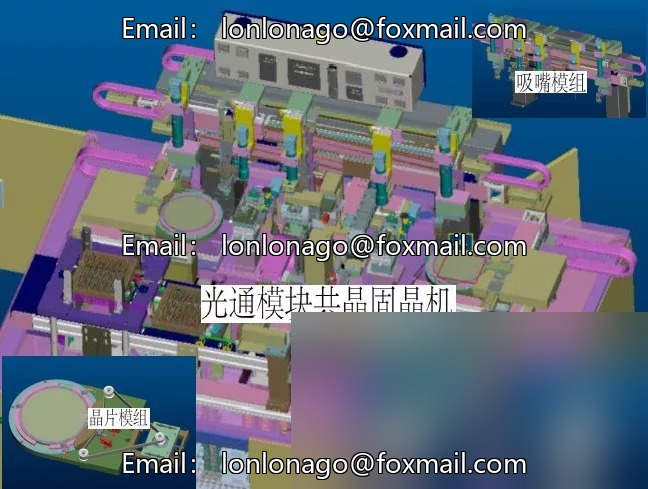

# Crystal Grinding Machine (COS Lightthrough Module)

## Body

Glass Crystal Machine (COS Optical Module)

There are details available for reference, and the reference value is significant.

creo4. 0 parts and assembly bodies (prt and asm files)
editable

There is an opportunity to take a direct photo.

Sales do not refund; do not respond to detailed inquiries; thank you.

Not providing technical support

Editable Creo4 parts and assembly files, plus detail content for the suction nozzle module, COS light-opening module eutectic solidification machine, and wafer module, are available for reference and have high value.

<!-- AI_ENRICHED -->

## Images

## Payment

Here is a pay link on Stripe ( https://buy.stripe.com/3cs8yP7sY87d0vu9AB ). Please contact me lonlonago@foxmail.com after funding $89, and I will send you a complete data files , thank you!

